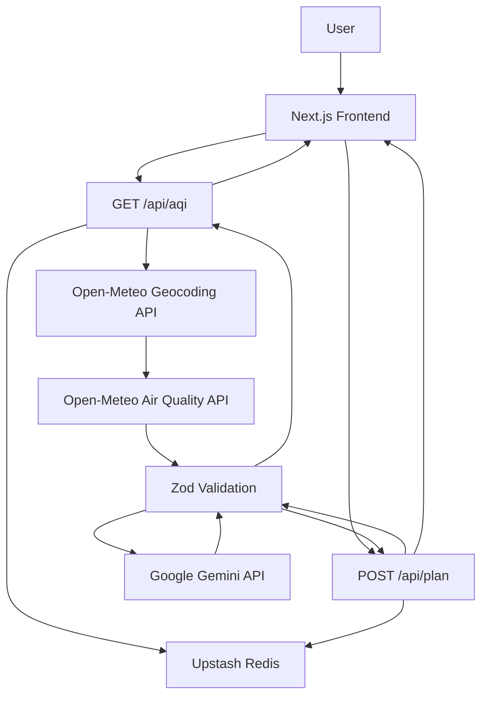
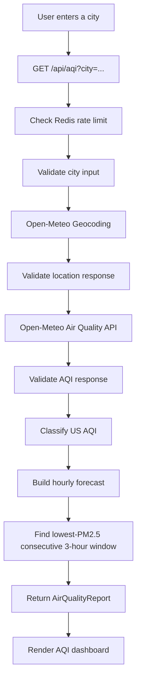
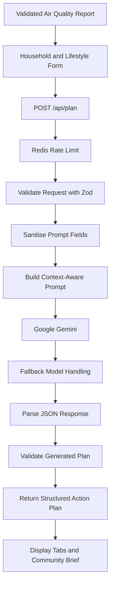

# VayuGuard — Urban Air Quality & Winter Smog Assistant

<p align="center">
  <strong>Understand the air. Protect your household. Make cleaner everyday choices.</strong>
</p>

<p align="center">
  <a href="https://uaqi-assistant.vercel.app/">
    
  </a>
  <a href="https://github.com/HimeshRoy/Urban-Air-Quality-Assistant">
    
  </a>
</p>

<p align="center">
  
  
  
  
  
  
  
  
</p>

---

## Overview

**VayuGuard** is an AI-powered urban air-quality assistant designed to help individuals and households understand changing air conditions and make more informed decisions during periods of urban pollution and winter smog.

Instead of presenting air-quality numbers alone, VayuGuard combines air-quality telemetry, hourly forecasts, household preferences, and generative AI to turn environmental data into practical daily guidance.

Users can search for a city, explore its current air-quality conditions, understand major pollutants, identify a comparatively lower-pollution three-hour period, and generate a personalised action plan based on their household and lifestyle.

### Live application

**[https://uaqi-assistant.vercel.app/](https://uaqi-assistant.vercel.app/)**

### Source code

**[https://github.com/HimeshRoy/Urban-Air-Quality-Assistant](https://github.com/HimeshRoy/Urban-Air-Quality-Assistant)**

---

## The Problem

Urban air pollution is not just an environmental statistic. It affects daily routines, outdoor activities, commuting decisions, ventilation, and the well-being of households.

During winter, cities can experience changing pollution levels throughout the day. However, people often face three practical problems:

1. **Difficult to interpret:** AQI and pollutant measurements are not always easy to understand.
2. **Difficult to act on:** A pollution reading does not automatically tell a household what to change in its daily routine.
3. **Difficult to personalise:** General pollution advice may not account for children, older adults, respiratory sensitivity, commute choices, cooking fuel, or home ventilation.

VayuGuard addresses these gaps by connecting environmental data with understandable explanations and AI-assisted household recommendations.

---

## Our Solution

VayuGuard follows a simple approach:

**Measure → Understand → Personalise → Act**

| Stage | What VayuGuard does |
|---|---|
| Measure | Retrieves current and hourly air-quality information for a selected city |
| Understand | Classifies US AQI and explains major pollutant measurements |
| Personalise | Collects household, commute, cooking, ventilation, and activity preferences |
| Act | Uses Google Gemini to generate a structured, personalised action plan |

The objective is not to replace official environmental monitoring or professional medical advice. It is to make available air-quality information easier to understand and more useful in everyday decisions.

---

## Key Features

### 1. City-Based Air Quality Search

- Search for a city by name.
- Quick-select commonly used cities.
- Retrieve location information through Open-Meteo Geocoding.
- Display current US AQI and pollutant measurements.
- Handle invalid locations and upstream API failures.

### 2. Air Quality and Pollutant Insights

The application presents:

- US AQI value and category.
- PM2.5 concentration.
- PM10 concentration.
- Nitrogen dioxide (NO₂).
- Ozone (O₃).
- Plain-language explanations of pollutant sources and effects.
- Category-based guidance for different air-quality conditions.

### 3. Hourly Air Quality Insights

- Displays hourly air-quality information.
- Helps users compare different parts of the day.
- Summarises conditions across morning, afternoon, evening, and night.
- Identifies a comparatively lower-PM2.5 three-hour period when reliable consecutive hourly observations are available.

The safest-window calculation only considers three genuinely consecutive hourly observations. If suitable observations are unavailable, the application displays a message instead of inventing a time window.

### 4. Household and Lifestyle Profiling

Users can provide information about:

- Household members:
  - Adults
  - Children
  - Older adults
  - People with respiratory sensitivity
- Primary commute:
  - Private car
  - Two-wheeler
  - Public transport
  - Walking or cycling
  - Work from home
- Home setup:
  - Air purifier availability
  - Cooking fuel
  - Ventilation arrangement
- Outdoor activities:
  - Morning walks
  - Evening exercise
  - School drop-offs
  - Minimal outdoor activity

This information is used as context for personalised recommendations.

### 5. Gemini-Powered Personalised Action Plans

Google Gemini generates a structured action plan using the submitted household profile and current air-quality context.

The generated plan contains three categories:

| Category | Purpose |
|---|---|
| Low-Emission Routine | Practical changes to daily routines and activities |
| Indoor Air Hacks | Suggestions for improving indoor air management |
| Sustainable Alternatives | Lower-emission commuting, energy, and household choices |

Each recommendation includes:

- Action title and explanation.
- Suggested timing or frequency.
- Personal health-impact explanation.
- Community emission-impact explanation.
- Estimated weekly CO₂e savings.
- Estimated PM2.5 exposure reduction.

The generated response is parsed and validated against a Zod schema before it is returned to the frontend.

### 6. Community Smog Brief

VayuGuard also generates a short community message that can be shared with neighbours, families, or residential welfare groups.

The message can be copied directly to the clipboard.

### 7. Security and Reliability

- Server-side API-key handling.
- Request validation using Zod.
- Runtime validation of external API responses.
- Redis-backed sliding-window rate limiting.
- Controlled API error responses.
- Upstream request caching.
- Browser-side cancellation of outdated city searches.
- Security-related HTTP response headers.

---

## Application Architecture

VayuGuard uses a Next.js application architecture. The browser communicates with server-side API routes, which handle external data providers, validation, rate limiting, and AI generation.



### Architecture responsibilities

| Layer | Responsibility |
|---|---|
| Frontend | City search, AQI display, household profiling, and action-plan presentation |
| API routes | Request handling, validation, rate limiting, and error responses |
| AQI service | Geocoding, air-quality retrieval, AQI classification, and safest-window calculation |
| AI service | Prompt construction, Gemini model selection, response parsing, and validation |
| Validation | Runtime validation of incoming requests, upstream data, and generated AI output |
| Redis | Shared rate-limit storage |
| External services | Open-Meteo environmental data and Google Gemini generation |

---

## Air Quality Data Flow

The air-quality workflow is designed to validate external data before using it.



### Data processing details

1. The user submits a city name.
2. The AQI API applies its rate limit.
3. The city input is validated.
4. Open-Meteo Geocoding resolves the location.
5. The geocoding response is checked using a Zod schema.
6. The Air Quality API retrieves current and hourly data.
7. The air-quality response is checked for valid values and consistent hourly array lengths.
8. The application classifies the US AQI value.
9. The hourly forecast is transformed into frontend-friendly data.
10. The safest available three-hour window is calculated.
11. A structured air-quality report is returned to the frontend.

---

## AI Action Plan Workflow

The AI workflow combines live air-quality context with the user's household profile.



### AI response validation

Gemini is instructed to return structured JSON containing:

- Risk summary.
- Low-emission routine recommendations.
- Indoor air recommendations.
- Sustainable alternatives.
- Community brief.

The response is parsed and validated using `AirQualityPlanSchema`. Invalid or malformed model output is rejected instead of being passed directly to the interface.

The application also supports configured and fallback Gemini model candidates when retryable upstream errors occur.

---

## Technology Stack

| Technology | Usage |
|---|---|
| Next.js 16 | Full-stack application framework and API routes |
| React 19 | Component-based user interface |
| TypeScript | Type-safe application development |
| Tailwind CSS 4 | Responsive interface styling |
| Lucide React | Interface icons |
| Google GenAI SDK | Gemini API integration |
| Google Gemini | AI-generated personalised action plans |
| Open-Meteo Geocoding API | City and coordinate lookup |
| Open-Meteo Air Quality API | Current and hourly air-quality information |
| Zod | Runtime data and request validation |
| Upstash Redis | Shared rate-limit storage |
| Upstash Ratelimit | Sliding-window rate limiting |
| Vitest | Automated testing |
| React Testing Library | Component-level testing |
| ESLint | Code-quality checks |
| Vercel | Application deployment |

---

## External Data and AI Services

### Open-Meteo

VayuGuard uses two Open-Meteo services.

**Geocoding API**

Resolves a city name into a location, including coordinates and available administrative information.

Endpoint:

`https://geocoding-api.open-meteo.com/v1/search`

**Air Quality API**

Retrieves current and hourly air-quality variables for the resolved coordinates.

Endpoint:

`https://air-quality-api.open-meteo.com/v1/air-quality`

Variables used include:

- `us_aqi`
- `pm2_5`
- `pm10`
- `nitrogen_dioxide`
- `ozone`

The application requests hourly US AQI and PM2.5 information for a one-day forecast.

### Google Gemini

Google Gemini is used to generate personalised air-quality action plans.

The AI integration is implemented in:

`src/lib/genai.ts`

The service receives:

- City context.
- Current US AQI.
- PM2.5 and PM10 values.
- AQI category.
- Calculated three-hour window.
- Household members.
- Commute mode.
- Cooking fuel.
- Ventilation setup.
- Outdoor activity.

The generated content is returned as structured JSON and validated before use.

### Upstash Redis

Upstash Redis provides shared storage for API rate limiting.

The implementation uses:

- `@upstash/redis`
- `@upstash/ratelimit`
- Sliding-window rate limiting.
- A shared Redis prefix: `vayuguard:ratelimit`

This avoids relying solely on process-local in-memory counters.

---

## API Documentation

### 1. Get Air Quality

`GET /api/aqi?city={city}`

Retrieves air-quality information for a city.

**Query parameters**

| Parameter | Type | Required | Description |
|---|---|---|---|
| `city` | String | Yes | City name to search |

**Example request**

```http
GET /api/aqi?city=New%20Delhi
```

**Successful response**

Returns a structured `AirQualityReport` containing:

- Location details.
- Current pollutant measurements.
- US AQI severity and guidance.
- Safest available three-hour window.
- Hourly forecast.

**Possible status codes**

| Status | Meaning |
|---|---|
| `200` | Air-quality report retrieved |
| `400` | Invalid city parameter |
| `404` | City not found |
| `429` | Rate limit exceeded |
| `502` | External weather or geocoding service error |
| `500` | Unexpected server error |

**Rate limit:** 30 requests per minute per client IP.

Successful responses use shared caching headers with a 15-minute shared cache duration and stale-while-revalidate behaviour.

### 2. Generate Personalised Action Plan

`POST /api/plan`

Generates a household-specific air-quality action plan.

**Headers**

```http
Content-Type: application/json
```

**Example request body**

```json
{
  "profile": {
    "city": "New Delhi",
    "householdMembers": [
      "adults",
      "children"
    ],
    "commuteMode": "public_transit",
    "homeSetup": {
      "hasAirPurifier": false,
      "cookingFuel": "lpg_gas",
      "ventilation": "cross_ventilation"
    },
    "outdoorActivity": "morning_walk"
  },
  "aqiContext": {
    "usAqi": 180,
    "pm25": 85.4,
    "pm10": 120.5,
    "category": "Unhealthy",
    "safestWindow": "2:00 PM – 5:00 PM"
  }
}
```

The values above are illustrative request data, not a live air-quality reading.

**Successful response structure**

```json
{
  "plan": {
    "riskSummary": "A household-specific risk summary.",
    "lowEmissionRoutine": [],
    "indoorAirHacks": [],
    "sustainableAlternatives": [],
    "communityBrief": "A shareable community message."
  },
  "model": "gemini-3.5-flash-lite",
  "generatedAt": "2026-01-01T10:00:00.000Z"
}
```

The example is a structural illustration. Actual recommendation arrays contain validated action items.

**Possible status codes**

| Status | Meaning |
|---|---|
| `200` | Action plan generated |
| `400` | Invalid JSON or request payload |
| `415` | Unsupported content type |
| `429` | Rate limit exceeded |
| `502` | AI generation or response validation failure |
| `503` | Gemini API configuration missing |
| `500` | Unexpected server error |

**Rate limit:** 10 requests per minute per client IP.

Generated action-plan responses use `Cache-Control: no-store`.

---

## Security and Engineering Practices

### Request validation

Incoming requests are validated with Zod before business logic or AI generation proceeds.

Relevant schemas are defined in:

`src/lib/schemas.ts`

### External response validation

Open-Meteo responses are treated as untrusted external data.

The application validates:

- Required fields.
- Numeric values.
- Latitude and longitude ranges.
- Pollutant value ranges.
- Hourly forecast array consistency.

Invalid upstream responses are rejected and handled as upstream service errors.

### AI response validation

Gemini output is not trusted as automatically valid.

The application:

1. Requests JSON output using a response schema.
2. Parses the returned text.
3. Handles malformed JSON.
4. Validates the result using Zod.
5. Returns only validated action-plan data.

### Rate limiting

Redis-backed sliding-window limits are applied before request validation and external service calls.

| Endpoint | Limit | Window |
|---|---:|---:|
| `/api/aqi` | 30 requests | 60 seconds |
| `/api/plan` | 10 requests | 60 seconds |

### HTTP security headers

The application configures the following headers in `next.config.ts`:

| Header | Configuration |
|---|---|
| `X-Content-Type-Options` | `nosniff` |
| `X-Frame-Options` | `DENY` |
| `Referrer-Policy` | `strict-origin-when-cross-origin` |
| `Permissions-Policy` | Restricts camera and microphone; limits geolocation to the same origin |

### API key protection

Gemini credentials are read server-side from environment variables. API keys should never be exposed in client-side code or committed to the repository.

---

## Caching Strategy

VayuGuard uses caching to reduce unnecessary upstream requests.

| Resource | Revalidation / Cache Behaviour |
|---|---|
| Open-Meteo Geocoding request | 3600 seconds |
| Open-Meteo Air Quality request | 900 seconds |
| Successful AQI API response | 900 seconds shared cache with 300 seconds stale-while-revalidate |
| AI-generated action plan | No-store |

The AQI data is therefore not guaranteed to be an instantaneous sensor reading.

---

## Project Structure

```text
Urban-Air-Quality-Assistant/
│
├── public/
│
├── src/
│   ├── app/
│   │   ├── api/
│   │   │   ├── aqi/
│   │   │   │   └── route.ts
│   │   │   │
│   │   │   └── plan/
│   │   │       └── route.ts
│   │   │
│   │   ├── globals.css
│   │   ├── layout.tsx
│   │   └── page.tsx
│   │
│   ├── components/
│   │   ├── ActionPlanTabs.tsx
│   │   ├── AqiBanner.tsx
│   │   ├── ImpactExplainer.tsx
│   │   └── LifestyleForm.tsx
│   │
│   └── lib/
│       ├── aqi.ts
│       ├── genai.ts
│       ├── rateLimit.ts
│       └── schemas.ts
│
├── tests/
│   ├── aqi.test.ts
│   ├── schemas.test.ts
│   ├── plan-api.test.ts
│   └── lifestyle-form.test.tsx
│
├── next.config.ts
├── package.json
├── tsconfig.json
├── vitest.config.ts
└── README.md
```

---

## Getting Started

### Prerequisites

Install the following before running the project:

- Node.js compatible with the Next.js 16 runtime requirements.
- npm.
- A Google Gemini API key.
- An Upstash Redis database with REST credentials.

### 1. Clone the repository

```bash
git clone https://github.com/HimeshRoy/Urban-Air-Quality-Assistant.git

cd Urban-Air-Quality-Assistant
```

### 2. Install dependencies

```bash
npm install
```

### 3. Configure environment variables

Create a file named `.env.local` in the project root.

```env
# Google Gemini
GEMINI_API_KEY=your_gemini_api_key

# Optional: Gemini model override
GEMINI_MODEL=gemini-3.5-flash-lite

# Upstash Redis
UPSTASH_REDIS_REST_URL=https://your-database.upstash.io
UPSTASH_REDIS_REST_TOKEN=your_upstash_rest_token
```

**Important:** Replace the placeholder values with actual credentials.

Do not commit `.env.local` or expose these credentials in frontend code.

The default Gemini model is `gemini-3.5-flash-lite`. `GEMINI_MODEL` can optionally override the first model candidate.

### 4. Run the development server

```bash
npm run dev
```

Open:

`http://localhost:3000`

### 5. Build for production

```bash
npm run build
```

### 6. Start the production server locally

```bash
npm run start
```

---

## Environment Variables

| Variable | Required | Description |
|---|---|---|
| `GEMINI_API_KEY` | Yes | Server-side Google Gemini API key |
| `GEMINI_MODEL` | No | Optional Gemini model override |
| `UPSTASH_REDIS_REST_URL` | Yes | Upstash Redis REST endpoint |
| `UPSTASH_REDIS_REST_TOKEN` | Yes | Upstash Redis REST authentication token |

The application uses `Redis.fromEnv()`, so the Upstash environment variables must be available to the server runtime.

For local development, configure them in `.env.local`.

For Vercel, configure them in the project's Environment Variables settings for the required deployment environments.

---

## Testing and Code Quality

VayuGuard uses Vitest and React Testing Library for automated testing.

### Run the test suite

```bash
npm run test
```

### Run ESLint

```bash
npm run lint
```

### Create a production build

```bash
npm run build
```

### Test coverage areas

| Test file | Area |
|---|---|
| `tests/aqi.test.ts` | AQI classification and air-quality calculations |
| `tests/schemas.test.ts` | Request and response schema validation |
| `tests/plan-api.test.ts` | Action-plan API behaviour |
| `tests/lifestyle-form.test.tsx` | Household profile form behaviour |

### Latest verified local checks

The latest reported project checks completed successfully:

- ESLint: no errors or warnings.
- Vitest: 4 test files passed.
- Test cases: 19 passed.
- Next.js production build: successful.
- TypeScript build checks: successful.

These are results from the development verification run and should not be interpreted as a claim that every possible production scenario has been tested.

---

## Deployment

The application is deployed using Vercel.

**Production URL:**  
[https://uaqi-assistant.vercel.app/](https://uaqi-assistant.vercel.app/)

### Deployment steps

1. Push the project to a GitHub repository.
2. Import the repository into Vercel.
3. Configure the required environment variables.
4. Deploy the application.
5. Verify the production homepage.
6. Test the city AQI endpoint.
7. Test AI action-plan generation.
8. Verify Upstash Redis rate limiting.

### Production environment configuration

Configure these variables in Vercel:

```text
GEMINI_API_KEY
GEMINI_MODEL
UPSTASH_REDIS_REST_URL
UPSTASH_REDIS_REST_TOKEN
```

The `GEMINI_MODEL` variable is optional. The remaining credentials are required for the corresponding services to operate.

---

## Design and User Experience

VayuGuard uses a dark, responsive interface designed to keep air-quality information readable and organised.

### Styling

The interface is styled with Tailwind CSS 4.

The global stylesheet is located at:

`src/app/globals.css`

The current global styling establishes a dark colour scheme, smooth scrolling, antialiased text, and visible keyboard-focus outlines.

```css
@import "tailwindcss";

:root {
  color-scheme: dark;
}

html {
  scroll-behavior: smooth;
}

body {
  background-color: #09090b;
  color: #f4f4f5;
  -webkit-font-smoothing: antialiased;
  -moz-osx-font-smoothing: grayscale;
}

:focus-visible {
  outline: 2px solid #34d399;
  outline-offset: 2px;
}
```

### Interface principles

- Responsive layouts for different screen sizes.
- Clear separation between AQI information and AI recommendations.
- Colour-coded AQI severity indicators.
- Readable pollutant descriptions.
- Keyboard-operable action-plan tabs.
- Visible focus indicators.
- Semantic form labels and section headings.
- Clear loading and error states.

---

## Assumptions and Limitations

Transparency is important when presenting environmental and AI-generated information.

### 1. US AQI, not CPCB AQI

The current implementation uses Open-Meteo's `us_aqi` variable and the corresponding US AQI category ranges.

It does **not** calculate or display India's CPCB National AQI.

Users in India should keep this distinction in mind when comparing VayuGuard values with official CPCB monitoring dashboards.

### 2. Modelled environmental data

Air-quality information is retrieved from Open-Meteo's Air Quality API.

The returned information is model-based environmental data and may not match a nearby government monitoring station or a street-level sensor.

Actual local conditions can vary with traffic, construction, weather, and neighbourhood-level sources.

### 3. Safest-window interpretation

The three-hour window is selected by comparing average PM2.5 across consecutive hourly forecast observations.

It represents a comparatively lower-PM2.5 period within the available forecast. It is not a guarantee that outdoor air is safe during that period.

If three consecutive hourly observations are not available, the application does not manufacture a window.

### 4. AI-generated impact estimates

The estimated CO₂e savings and PM2.5 exposure reductions are generated by Gemini based on the supplied context.

They are illustrative estimates, not direct measurements, validated personal exposure calculations, or guaranteed emission reductions.

Actual outcomes depend on individual behaviour, building conditions, pollution sources, and other environmental factors.

### 5. Health guidance

VayuGuard provides general environmental awareness and practical suggestions.

It does not diagnose medical conditions, prescribe medication, or replace advice from qualified healthcare professionals or official public-health authorities.

Anyone experiencing acute or serious respiratory symptoms should seek appropriate medical care.

### 6. External service dependency

The application depends on Open-Meteo, Google Gemini, and Upstash Redis.

Service interruptions, API limits, unavailable credentials, or network failures may affect the corresponding features.

---

## Future Improvements

Potential directions for further development include:

- Integration of India's CPCB AQI data and category standards.
- More granular location-level monitoring where reliable data is available.
- Historical pollution trends and comparisons.
- More detailed forecast visualisations.
- Multilingual guidance for Indian households.
- Optional alerts for significant air-quality changes.
- Better calibration and transparent sourcing of environmental impact estimates.
- Additional automated tests for external service failures and rate-limit edge cases.

These are possible future enhancements and are not represented as currently implemented features.

---

## Challenge Alignment

This project was developed for the **Urban Air Quality Assistant** problem statement.

| Challenge requirement | VayuGuard implementation |
|---|---|
| Environmental data integration | Open-Meteo Geocoding and Air Quality APIs |
| User-facing air-quality insights | US AQI, pollutant details, and hourly forecast |
| Personalised assistance | Gemini-powered household action plans |
| Practical recommendations | Daily routine, indoor air, and sustainable alternatives |
| Data validation | Zod schemas for requests and external responses |
| Responsible API usage | Redis-backed rate limiting and caching |
| Maintainable implementation | Modular services, API routes, and reusable components |
| Testing | Vitest and React Testing Library |

---

## Contributing

Contributions, suggestions, and feedback are welcome.

1. Fork the repository.
2. Create a feature branch in your fork.
3. Make the required changes.
4. Run the tests and lint checks.
5. Submit a pull request with a clear description of the changes.

Please avoid committing API keys, tokens, or other sensitive configuration.

---

## Acknowledgements

- [Open-Meteo](https://open-meteo.com/) — Geocoding and air-quality data.
- [Google Gemini](https://ai.google.dev/) — Generative AI for personalised action plans.
- [Upstash](https://upstash.com/) — Redis-based rate limiting.
- [Vercel](https://vercel.com/) — Application hosting and deployment.
- [Next.js](https://nextjs.org/) — Full-stack React framework.

---

## Project Information

**Project:** VayuGuard — Urban Air Quality & Winter Smog Assistant  
**Repository:** [HimeshRoy/Urban-Air-Quality-Assistant](https://github.com/HimeshRoy/Urban-Air-Quality-Assistant)  
**Live Demo:** [uaqi-assistant.vercel.app](https://uaqi-assistant.vercel.app/)  
**Developer:** [Himesh Roy](https://github.com/HimeshRoy)

---

<p align="center">
  <strong>Better air awareness starts with better everyday decisions.</strong>
</p>

<p align="center">
  Built with care for healthier households and cleaner urban communities.
</p>